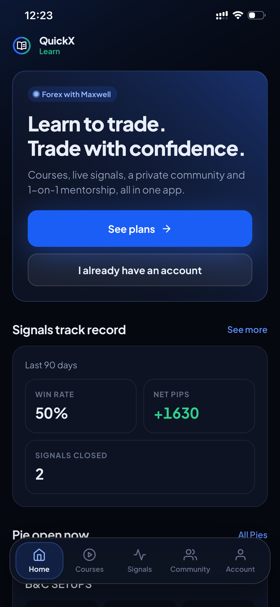
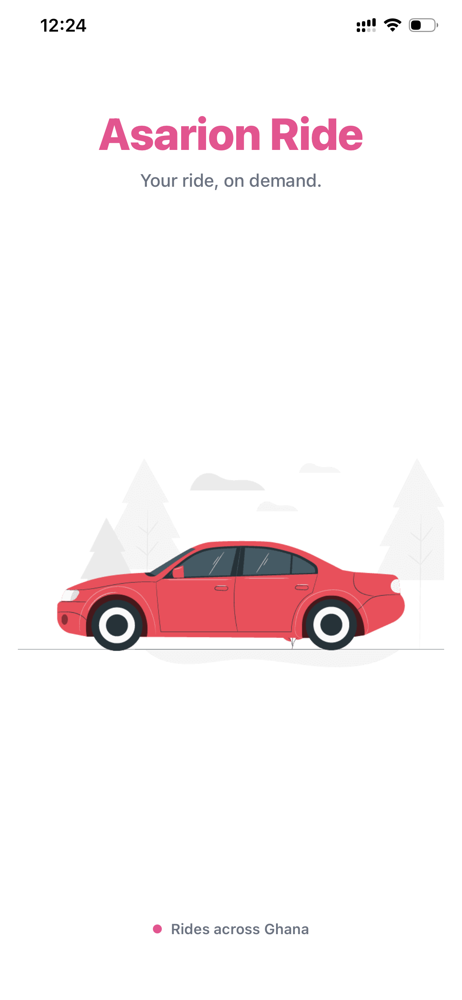
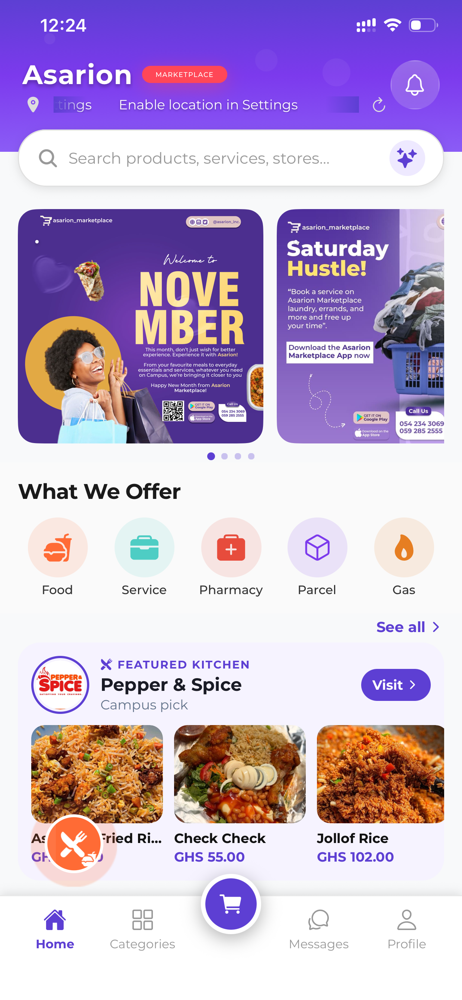
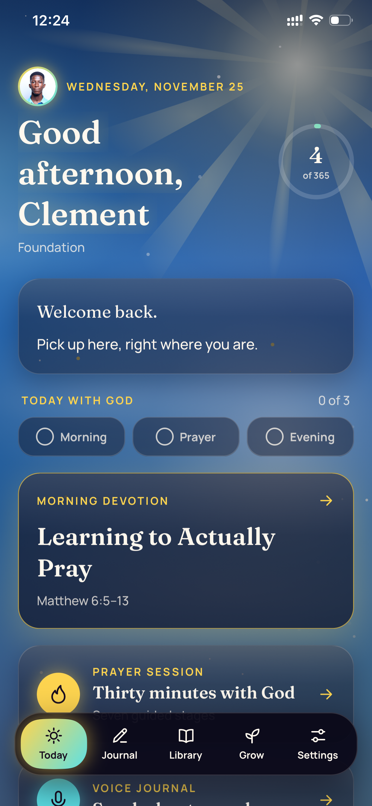
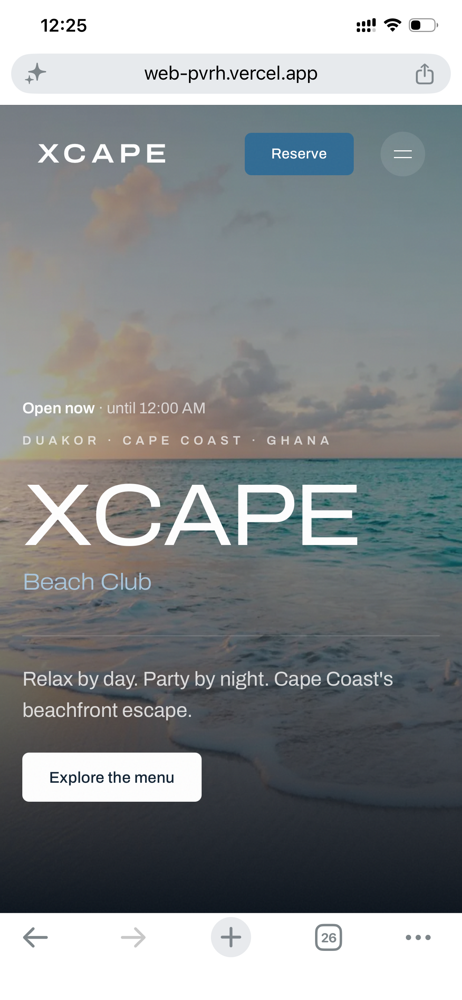
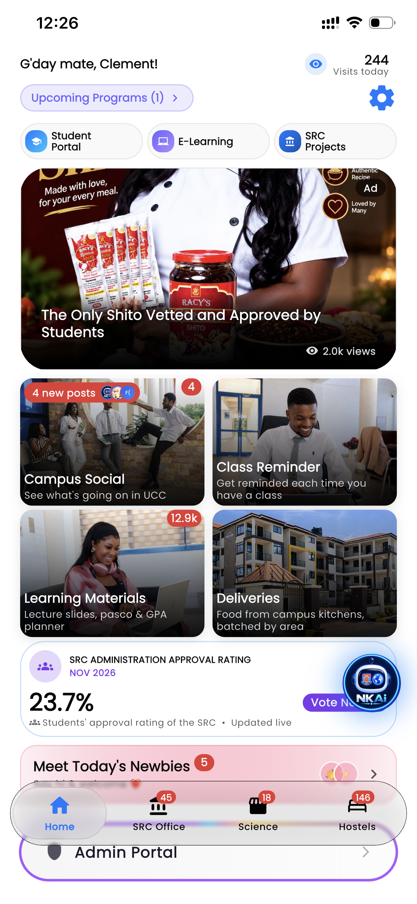

<!-- Header -->
<p align="center">
  
</p>

<p align="center">
  <a href="https://linkedin.com/in/clement-obeng"></a>
  <a href="mailto:clementobeng333@gmail.com"></a>
  <a href="https://medium.com/@quirkydude0_0"></a>
  <a href="https://bsky.app/profile/quirkydude0"></a>
  <a href="https://codepen.io/quirkydude0_0"></a>
  <a href="https://buymeacoffee.com/quirkydude0"></a>
</p>

<p align="center">
  
</p>


## ⚡ The short version

I'm a Computer Science student in Ghana who builds **full-stack products end to end**: the API, the database, the admin panel, the mobile app, and the deploy. I've shipped for student governments, churches, startups and businesses, and lately a lot of **AI-powered tools** that take on real work.

```ts
const clement = {
  role:       "Full-Stack Developer · System Builder · AI Explorer",
  based:      "Ghana 🇬🇭",
  building:   ["AI research tools", "client web platforms", "health-tech on mobile"],
  daily:      ["TypeScript", "Next.js", "NestJS", "Flutter", "Python", "PostgreSQL"],
  exploring:  ["LLM agents & tool-use", "cybersecurity", "system performance"],
  philosophy: "Ship it, measure it, make it trustworthy.",
};
```


## 🚀 Featured projects

<p align="center">
  <a href="https://github.com/Quirkydude/MaHyp"></a>
  <a href="https://github.com/Quirkydude/FocusPal"></a>
  <a href="https://github.com/Asamoah4284/QuickX"></a>
  <a href="https://github.com/Asamoah4284/SMS"></a>
  <a href="https://github.com/KamarTec/Agritech-Platform"></a>
  <a href="https://github.com/Quirkydude/dws26"></a>
</p>

### 📸 In action

<!-- Images live in assets/screenshots/. See the README in that folder. -->
<table>
  <tr>
    <td width="33%" align="center"><br/><sub><!-- caption 1 --></sub></td>
    <td width="33%" align="center"><br/><sub><!-- caption 2 --></sub></td>
    <td width="33%" align="center"><br/><sub><!-- caption 3 --></sub></td>
  </tr>
  <tr>
    <td width="33%" align="center"><br/><sub><!-- caption 4 --></sub></td>
    <td width="33%" align="center"><br/><sub><!-- caption 5 --></sub></td>
    <td width="33%" align="center"><br/><sub><!-- caption 6 --></sub></td>
  </tr>
</table>

### 🔒 Private & client work

Most of my work runs in production behind private repos. Some highlights:

| | Project | What it is | Stack |
| --- | --- | --- | --- |
| 🎓 | **UCC SRC App (63rd Administration)** | Official mobile app for the University of Cape Coast Students' Representative Council, plus its backend and landing page | Flutter · Node.js · Next.js |
| 🛍️ | **Sellzan** | Multi-platform product: Flutter app, React Native version and TypeScript backend | Flutter · React Native · TypeScript |
| 💼 | **Business 247** | Mobile application for Business 247 | Flutter · Dart |
| 📚 | **ScholarDesk** | AI research-assistant platform with per-user quotas, admin tooling and a writing pipeline | Next.js · TypeScript · LLMs |
| 🧪 | **PanelSim** | Survey builder where AI personas answer as synthetic respondents, with an analytics dashboard | Next.js · SQLite · LLM APIs |
| 🌐 | **Client websites** | Hospitality, travel & tours and event-registration sites with their own admin panels | Next.js · NestJS · PostgreSQL |


## 🧰 Toolbox

<p align="center"><b>Languages</b><br/>
  
</p>

<p align="center"><b>Frameworks & runtimes</b><br/>
  
</p>

<p align="center"><b>Data, cloud & tooling</b><br/>
  
</p>

<p align="center"><b>Design</b><br/>
  
</p>

<p align="center">
  
  
  
  
  
  
  
  
</p>


## 📈 By the numbers

<p align="center">
  
  
</p>

<p align="center">
  
</p>

<p align="center">
  
</p>

<!-- Snake: generated daily by .github/workflows/snake.yml -->
<p align="center">
  <picture>
    <source media="(prefers-color-scheme: dark)" srcset="https://raw.githubusercontent.com/Quirkydude/Quirkydude/output/github-snake-dark.svg" />
    <source media="(prefers-color-scheme: light)" srcset="https://raw.githubusercontent.com/Quirkydude/Quirkydude/output/github-snake.svg" />
    
  </picture>
</p>


<table>
<tr>
<td valign="top" width="50%">

### ✍️ Latest writing
<!-- BLOG-POST-LIST:START -->
<!-- BLOG-POST-LIST:END -->

</td>
<td valign="top" width="50%">

### 🔥 Recent activity
<!--START_SECTION:activity-->
1. 🎉 Merged PR [#2](https://github.com/Asamoah4284/QuickX/pull/2) in [Asamoah4284/QuickX](https://github.com/Asamoah4284/QuickX)
2. 💪 Opened PR [#1](https://github.com/Asamoah4284/Quickx-App/pull/1) in [Asamoah4284/Quickx-App](https://github.com/Asamoah4284/Quickx-App)
3. 💪 Opened PR [#2](https://github.com/Asamoah4284/QuickX/pull/2) in [Asamoah4284/QuickX](https://github.com/Asamoah4284/QuickX)
4. 🎉 Merged PR [#1](https://github.com/Asamoah4284/QuickX/pull/1) in [Asamoah4284/QuickX](https://github.com/Asamoah4284/QuickX)
5. 💪 Opened PR [#1](https://github.com/Asamoah4284/QuickX/pull/1) in [Asamoah4284/QuickX](https://github.com/Asamoah4284/QuickX)
<!--END_SECTION:activity-->

</td>
</tr>
</table>


## 🤝 Let's work together

I'm open to **freelance builds, internships and collaborations**, especially where AI meets a real-world problem.
If you've got an idea that needs a backend, a frontend *and* someone who'll actually finish it, [send me an email](mailto:clementobeng333@gmail.com).

<p align="center"><sub>Built in Ghana 🇬🇭 · Always shipping</sub></p>
